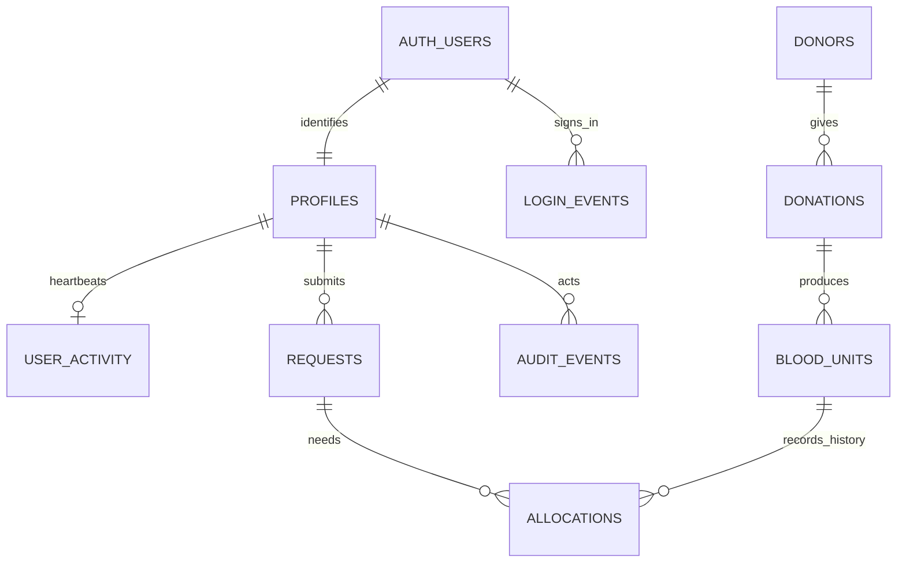

# Database design



`stock_thresholds` defines the minimum PRBC inventory per blood group. `settings` stores the expiry-alert window. `stock_summary` is a security-invoker view joining thresholds and usable stock. No mutable stock counters are stored. `profiles` never contains a password; Supabase Auth owns credentials.

## Transactions

A request moves **pending → approved → reserved → issued**, or to **cancelled** before issue. Staff approval records a compatibility reference and actor. It is a recorded human decision, not an automated clinical recommendation.

`reserve_request` locks the request. Eligible units match the exact group and product, are released and unexpired, and have no live allocation. Candidates are ordered by `expires_at, unit_id` and locked with `FOR UPDATE SKIP LOCKED`. The function checks the complete quantity before inserting allocations. PostgreSQL rolls back the complete statement if anything fails. Locked stock can cause a safe shortage response; retry after the competing transaction finishes. A partial unique index prevents two reserved/issued allocations for the same unit. Repeat reservation calls return existing allocations rather than allocating additional units.

`issue_request` locks the request and units and rechecks expiry, release, group/product, quantity and the recorded approval. Cancellation changes only reserved allocations; issued history cannot be cancelled. `review_unit` locks the unit and refuses changes once it is allocated.

Units enter quarantine. Expiry is entered from the label and must follow collection through `add_unit`; no universal shelf life is assumed. Only PRBC is supported in this version.

## Permissions

| Capability | Requester | Staff | Administrator |
|---|---|---|---|
| Create and see own requests | Yes | Yes | Yes |
| See others' requests | No | Yes | Yes |
| Donors, donations, screening and inventory | No | Yes | Yes |
| Approve, reserve and issue | No | Yes | Yes |
| Cancel own unissued request | Yes | Yes | Yes |
| Read audit history | No | Yes | Yes |
| User statistics, thresholds and app roles | No | No | Yes |

Anonymous users have no table access or callable workflow functions. Authenticated users have SELECT grants guarded by RLS; all application writes use specific RPCs. Security-definer functions use an empty search path, qualified table names, explicit role checks, and restricted execute grants. Internal audit/profile/session trigger functions cannot be invoked by clients. Authenticated users cannot edit a profile directly or choose their own role. The SQL editor/project owner remains privileged and must be protected separately.

## Activity metrics

An Auth session-insert trigger records newly issued sign-in sessions server-side; the browser cannot forge login history. Refreshing an existing session does not count as another sign-in event. Statistics count distinct accounts since midnight Asia/Kolkata. Authentication methods that reuse a session need validation before enabling them; this project targets password sign-in.

A visible signed-in page sends a heartbeat every minute. The server attributes identity and time. One row per user deduplicates tabs; rows older than five minutes do not count. Signing out removes recent activity for that user; another open tab may renew it on its next heartbeat. It is an estimate of recent activity, not an exact presence indicator.

## Useful SQL reports (project owner / SQL editor)

```sql
select * from public.stock_summary order by blood_group;

select d.name, count(distinct n.donation_id) as donations,
       count(u.unit_id) as units
from public.donors d
left join public.donations n using(donor_id)
left join public.blood_units u using(donation_id)
group by d.donor_id, d.name;

select r.request_id, r.patient_ref, r.status, a.unit_id, a.status as allocation_status
from public.requests r
left join public.allocations a using(request_id)
order by r.request_id, a.allocation_id;
```

## Portability

Keep the schema, seed script and source. Export operational tables separately through supported Supabase export/backup tools. Database rows alone do not move Auth credentials, confirmation settings, role provisioning, password policy, redirect URLs or delivery providers. Recreate those deliberately on a new backend; never include service keys or passwords in a submission archive.
